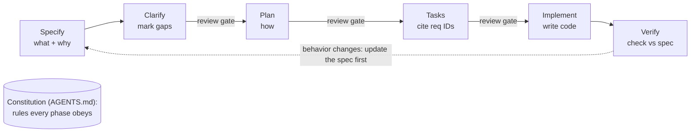

# Spec writing: best practices 2026 and gap assessment

Reference doc, not a PRD: no `Status:` line (see [../README.md](../README.md)). Research and
assessment from 2026-10-29.

## Outcome

Decided on 2026-10-29: the agile format. User stories ("As a… I want… so that…") with
Given/When/Then acceptance criteria, and one-line rules for pure constraints. Implemented:

- The `spec-writing` skill and its PRD template in `.agents/skills/spec-writing/`.
- A "Start from the spec" step in the `tdd` skill: one failing test per API-level criterion,
  mapped in the PR body.
- AGENTS.md loads `spec-writing` for `specs/` changes. `specs/README.md` points to the template.
- The clipped Atlassian page in `specs/prd-template/` is removed.

Not done yet: an ADR log, section-name linting in `specs:index`, a glossary, and the cleanup of
`sw-dev-lifecycle.md` and the root `*-strategy.md` files. Existing `slices.md` files keep their
copied rules; the skill stops new ones from doing so.

Recommendation 2 below predates the decision. Given/When/Then replaces "plain bullets or EARS".

## Summary

In 2026, specs are written for two readers: humans and AI coding agents. The pattern that won is
called spec-driven development (SDD). The spec is the source of truth and lives in the repo. Code
is checked against it.

The sources agree on five points:

- **Pick the doc by the question it answers.** PR/FAQ, pitch, PRD, design doc, RFC and ADR each
  do one job.
- **Keep specs short.** 1 to 3 pages. Split anything bigger.
- **Separate what from how.** Requirements carry no tech choices. Design and tasks do.
- **Write testable acceptance criteria.** Use Gherkin or EARS, and include the error paths.
- **Gate the phases.** Review the spec before the plan, the plan before the tasks, the tasks
  before the code.

## Document types

Each type answers one question. Mixing them up is the most common failure. One example is "we
have 200 ADRs and nobody reads them".

| Question                                         | Document                                                                                                                                 | Lifespan                      | Typical length               |
| ------------------------------------------------ | ---------------------------------------------------------------------------------------------------------------------------------------- | ----------------------------- | ---------------------------- |
| Will anyone want this?                           | [PR/FAQ](https://blog.logrocket.com/product-management/pr-faq-method-product-innovation/) (Amazon working backwards)                     | Thrown away once decided      | PR under 1 page, FAQ up to 5 |
| What do we bet in a fixed time box?              | Shape Up pitch: problem, appetite, solution, rabbit holes, no-gos                                                                        | One cycle                     | 1 to 2 pages                 |
| What do we build, and how do we know it is done? | PRD / spec                                                                                                                               | Living until shipped          | 1 to 3 pages                 |
| How will we build it?                            | Design doc / plan                                                                                                                        | Kept current with the system  | As needed                    |
| Do we agree on this big change?                  | [RFC](https://itnext.io/how-to-make-architecture-decisions-rfcs-adrs-and-getting-everyone-aligned-ab82e5384d2f) with a decision deadline | Editable until decided        | 1 to 3 pages                 |
| What did we decide, and why?                     | [ADR](https://www.catio.tech/blog/architecture-decision-record)                                                                          | Never edited, only superseded | 1 to 2 pages                 |

The usual flow: an RFC proposes, an ADR records the outcome, and a design doc describes the
resulting system with links to its ADRs. A PR/FAQ comes before a PRD and feeds its problem and
success sections.

## Lean PRD anatomy

A 2026 PRD is short and starts with the problem. Its job, in one source's words: "guide a
decision, not preserve every conversation." Each extra section lowers the chance anyone reads it.
The sections the sources converge on:

1. **Header.** Status, owner, date, linked issue.
2. **Problem and audience.** Evidence first. Hunches are labelled as assumptions.
3. **Outcome and success signals.** One primary metric, plus guardrails (what must not get
   worse).
4. **Scope.** In scope, and an explicit out-of-scope list. The sources stress the second part.
5. **Behavior.** User stories or flows, in user language.
6. **Acceptance criteria.** Testable, including the error paths.
7. **Non-functional requirements.** Only the ones at risk.
8. **Constraints and prior decisions.** Links to ADRs, so agents and people don't reopen settled
   choices.
9. **Open questions and risks.** Unknowns are marked, not guessed.

For small enhancements there is a compressed form: problem, goal metric, scope in and out, 3 to 5
acceptance criteria, and only the risky NFRs.

## User stories and acceptance criteria

A story says what and why. Its acceptance criteria say how we know it is done. Acceptance
criteria are mandatory, and a story needs 1 to 3 of them. Four or more means the story should be
split.

- **Story format:** "As a [role], I want [goal], so that [benefit]." Check it against INVEST:
  independent, negotiable, valuable, estimable, small, testable
  ([Cucumber](https://cucumber.io/docs/terms/user-story/)).
- **Job story alternative:** "When [situation], I want [motivation], so I can [outcome]." Use it
  when the situation matters more than the role.
- **Describe behavior, not implementation.** Write criteria before development starts, together
  with the people who build and test it.

Two notations are in use:

| Notation                                           | Shape                                             | Best for                                                |
| -------------------------------------------------- | ------------------------------------------------- | ------------------------------------------------------- |
| Gherkin                                            | Given / When / Then, one journey per scenario     | Criteria that become executable tests (BDD, Playwright) |
| [EARS](https://kiro.dev/docs/specs/feature-specs/) | WHEN / WHILE / IF-THEN / WHERE + THE SYSTEM SHALL | Agent-readable requirements (Kiro, Spec Kit style)      |

The five EARS patterns:

- Ubiquitous: `THE SYSTEM SHALL …`
- Event: `WHEN <event> THE SYSTEM SHALL …`
- State: `WHILE <state> THE SYSTEM SHALL …`
- Unwanted behavior: `IF <condition> THEN THE SYSTEM SHALL …`
- Optional feature: `WHERE <feature is enabled> THE SYSTEM SHALL …`

A useful check: requirements with no IF/THEN lines are almost always unfinished, because the
error paths are missing. A second check: "THE SYSTEM SHALL use Redis" is a design decision
dressed as a requirement.

## ADR conventions

An ADR records one decision in a page or two, and is never edited after acceptance
([Fowler](https://www.martinfowler.com/bliki)).

- **Template.** Plain Nygard for most teams. MADR when you want more structure.
- **Fields.** Status (Proposed, Accepted, Rejected, Deprecated, Superseded), Date, Deciders,
  Context, Options with tradeoffs, Decision, Consequences.
- **Writing.** Active voice: "We chose X", not "It was decided". Decision first (inverted
  pyramid).
- **Changes.** A changed decision gets a new ADR that links the one it supersedes.
- **Storage.** Markdown in the repo, one log per system, stable IDs, links between related ADRs.
- **Freshness.** Optionally add `Last verified:` next to `Date:`.
- **Volume.** A 12-person team writes 20 to 40 in year one, then 1 or 2 a month. Five a week
  means Slack threads are being recorded as ADRs.

## Spec-driven workflow for AI agents

GitHub Spec Kit, Kiro and OpenSpec all use the same shape. A project-wide constitution, then
requirements, then design, then tasks, with a human review between phases
([DEV](https://dev.to/krlz/spec-driven-development-in-2026-what-it-is-the-tooling-and-how-teams-actually-use-it-2fk2),
[Kiro](https://kiro.dev/docs/specs/feature-specs/)).

The practices behind it:

- **Constitution first.** One rules file (AGENTS.md) that every spec inherits. It holds stack,
  testing and dependency rules.
- **One folder per feature.** For example `specs/NNN-feature/{spec,plan,tasks}.md` (Kiro:
  `requirements.md`, `design.md`, `tasks.md`, plus `bugfix.md` for bugs).
- **Mark unknowns.** Spec Kit uses `[NEEDS CLARIFICATION]` so the agent flags gaps instead of
  inventing answers.
- **Traceability.** Each task ends with the requirement IDs it satisfies, e.g.
  `_Requirements: 1.1, 3.2_`.
- **Size the tasks.** Each phase is 5 to 15 minutes of agent work and ends in something a person
  can verify.
- **Verify separately.** A second agent or reviewer checks the output against the spec, not
  against the implementer's summary.
- **Spec in the repo.** Versioned with the code. When behavior changes, the spec changes first.
- **Don't over-build.** AGENTS.md plus one spec per feature is enough for many teams. Add
  structure only where ambiguity keeps hurting.

## Gap assessment: RAGNA Studio on 2026-10-29

The lifecycle side is strong. Status vocabulary, generated index, standards checklist and
out-of-scope sections are all at or above the norm. The weak side is the requirements themselves.
There is no usable template, almost no testable acceptance criteria, and what and how are mixed
in long docs.

Snapshot of `specs/`: 109 Markdown files, 81 with a Status line (61 implemented, 8 proposed, 2
decided, 1 in progress, 4 deferred, 2 superseded, 1 non-standard).

| Area                | Best practice                                                | RAGNA on 2026-10-29                                                                                                                               | Gap    |
| ------------------- | ------------------------------------------------------------ | ------------------------------------------------------------------------------------------------------------------------------------------------- | ------ |
| Template            | One lean template every PRD follows                          | `specs/prd-template/` held a clipped Atlassian web page, not a template                                                                           | High   |
| Acceptance criteria | Mandatory, testable, 1 to 3 per story, error paths included  | The term appears in 1 of 81 docs. No Gherkin or EARS anywhere                                                                                     | High   |
| What vs how         | Requirements free of tech choices; design and tasks separate | PRDs mix requirements with schema, API and per-package changes (headings like "Schema", "Changes by package")                                     | Medium |
| Length              | 1 to 3 pages, split when bigger                              | Median 166 lines, p90 368, max 999 (`credits/prd.md`)                                                                                             | Medium |
| User stories        | Stories with IDs                                             | Only `integrations/prd.md` (US-1, US-2 …), the newest PRD                                                                                         | Medium |
| Decisions           | ADR log: one decision per file, superseded by link           | Decisions live in "Decisions" sections inside 28 PRDs. No ADR log, so a single decision can't be found or superseded on its own                   | Medium |
| Traceability        | Tasks cite requirement IDs                                   | 6 features have `slices.md` with contracts, but slices can't cite IDs that don't exist                                                            | Medium |
| Living spec         | Spec updated when behavior changes                           | Implemented PRDs freeze. Later changes come as `*-change-request.md` (7 in email). Current behavior is only in `overview.md` and `apps/docs`      | Medium |
| Section names       | Fixed headings                                               | Same idea, many names: "Non-goals", "Non-goals (v1)", "Out of scope", "Later (explicitly deferred)"; "Decisions" vs "Design decisions (proposed)" | Low    |
| Success signals     | Primary metric plus guardrails                               | No doc has one                                                                                                                                    | Low    |
| Unknowns            | One marker, e.g. `[NEEDS CLARIFICATION]`                     | "Open questions" in 19 docs, "Open points" in 6, under different names                                                                            | Low    |
| Issue link          | Issue in the header                                          | 1 spec cites its issue. The rule is new (issues since 2026-10-24)                                                                                 | Low    |
| Noise               | `specs/` holds only decided technical docs                   | `sw-dev-lifecycle.md` is a generic clipped article. Three `*-strategy.md` files sit at the root and need a check against the public-repo rule     | Low    |
| Constitution        | One rules file every spec inherits                           | AGENTS.md does this. `slices.md` files repeat a "Rules for every slice" block                                                                     | Met    |
| Out of scope        | Named explicitly                                             | 64 of 81 docs have it                                                                                                                             | Met    |
| Status lifecycle    | Defined vocabulary, visible state                            | 6 values, generated `INDEX.md`, `overview.md`                                                                                                     | Met    |
| Cross-cutting rules | Inherited, not re-decided                                    | `specs/standards/` with a per-PRD checklist                                                                                                       | Met    |

## Matt Pocock's skills

[mattpocock/skills](https://github.com/mattpocock/skills) treats the spec as a short-lived issue,
not a repo document. What lasts in the repo is a glossary and a few ADRs. The README explicitly
positions it against frameworks like Spec Kit, BMAD and GSD that "own the process". Instead, it
offers small skills you compose yourself.

The flow, one skill per step:

1. **Align first.** `/grill-me` or `/grill-with-docs` interviews you until every branch of the
   design is resolved. The docs variant also updates `GLOSSARY.md` and ADRs as you go.
2. **Spec.** `/to-spec` writes up the conversation without a new interview and publishes it as an
   issue labelled `ready-for-agent`. Template: Problem, Solution, a long numbered list of user
   stories, Implementation Decisions, Testing Decisions, Out of Scope, Further Notes. It must not
   contain file paths or code, because they go stale.
3. **Test seams before writing.** The spec names where the feature will be tested, as few seams
   as possible, ideally one. The user confirms them.
4. **Tickets.** `/to-tickets` breaks the spec into tracer-bullet vertical slices (schema, API, UI
   and tests together). Each slice fits one fresh context window, carries checkbox acceptance
   criteria, and declares which tickets block it. On GitHub they become sub-issues with native
   blocking links.
5. **Build.** `/implement-spec` treats tickets as a task graph. It runs one fresh subagent per
   ready ticket with `/tdd` on an integration branch, then a final `/code-review`.
6. **Review on two axes.** Standards (repo rules) and Spec (missing items, scope creep, wrong
   implementation, each quoting the spec line). The two run as separate subagents and are never
   merged.

What stays in the repo:

- **`GLOSSARY.md`:** a domain language. One chosen term per concept, synonyms listed under
  `_Avoid_`, one or two sentences each. He calls it "the single coolest technique in this repo".
- **ADRs** in `docs/adr/0001-slug.md`. The minimum is 1 to 3 sentences: context, decision, why.
  Status, options and consequences are optional. Write one only when all three hold: hard to
  reverse, surprising without context, and a real trade-off.
- **`.out-of-scope/`:** one file per rejected request type, with the reason and links to the
  issues that asked for it.

For work bigger than one session, `/wayfinder` keeps a map issue of decision tickets and resolves
them one by one before any spec is written.

## GitHub Spec Kit

[github/spec-kit](https://github.com/github/spec-kit) is maintained by GitHub, a Microsoft
subsidiary. It is the opposite of Pocock's approach. The spec is the long-lived source of truth in
the repo, and a toolkit runs the process. Its manifesto (`spec-driven.md`) says it outright: "code
serves specifications".

The flow: `/speckit-constitution` once per project, then `/speckit-specify` → `/speckit-clarify`
→ `/speckit-plan` → `/speckit-tasks` → `/speckit-implement` → `/speckit-converge` per feature,
with a human review after each step. `/speckit-analyze` and `/speckit-checklist` run quality
checks.

The artifacts, in `specs/NNN-feature/`:

| File                                                          | What it holds                                                                                                                                      | Notable rules                                                                                                       |
| ------------------------------------------------------------- | -------------------------------------------------------------------------------------------------------------------------------------------------- | ------------------------------------------------------------------------------------------------------------------- |
| `constitution.md` (project)                                   | Numbered principles, constraints, governance, version                                                                                              | Overrides everything. A conflict with it is always a CRITICAL finding                                               |
| `spec.md`                                                     | User stories ranked P1, P2, P3. Given/When/Then scenarios. Edge cases. `FR-001` requirements. Key entities. `SC-001` success criteria. Assumptions | No tech stack, APIs or code structure. Written for business stakeholders. At most 3 `[NEEDS CLARIFICATION]` markers |
| `checklists/requirements.md`                                  | Spec quality checklist                                                                                                                             | "Unit tests for English": checks the requirements themselves, not the code                                          |
| `plan.md`                                                     | Technical context, Constitution Check gate, project structure, complexity tracking                                                                 | Unknown values are written as `NEEDS CLARIFICATION`                                                                 |
| `research.md`, `data-model.md`, `contracts/`, `quickstart.md` | Plan outputs                                                                                                                                       | Design split into separate files                                                                                    |
| `tasks.md`                                                    | `T001 [P] [US1]` tasks, grouped by story, phases Setup → Foundational → one per story                                                              | `[P]` marks tasks that can run in parallel. `[US1]` links a task to its story. Exact file paths                     |

Rules worth noting:

- **Each story is an MVP slice.** It must be testable, deployable and demoable on its own, and
  carries an "Independent Test" line.
- **Success criteria are technology-agnostic and measurable.** For example: "account creation in
  under 2 minutes".
- **Clarify asks at most 5 questions.** Each is multiple choice or a short answer, picked by
  impact × uncertainty, and the answers are written back into the spec.
- **Analyze is read-only.** It checks spec, plan and tasks against each other and the
  constitution, and rates findings CRITICAL to LOW. An untestable acceptance criterion counts as
  HIGH.
- **Converge closes the loop.** It compares the code to the spec and appends the unbuilt work to
  `tasks.md`. You repeat implement and converge until it reports `Converged`.
- **Beyond features:** extensions for bug fixing (`.specify/bugs/`, verdict
  verified/partial/failed) and idea assessment (go / needs-clarification / kill). Presets and
  catalogs let a team adapt the templates.
- **Issue sync is deprecated.** The command that turned tasks into GitHub issues is marked
  deprecated. The repo files are the system of record.

## Side by side

RAGNA already sits between the two. Specs live in the repo, as in Spec Kit. Work is split into
slices and handed to subagents, closer to Pocock. The best fit is to borrow pieces from each, not
to adopt either toolkit as a whole.

| Dimension            | Pocock skills                                                                           | Spec Kit                                                      | RAGNA on 2026-10-29                            |
| -------------------- | --------------------------------------------------------------------------------------- | ------------------------------------------------------------- | ---------------------------------------------- |
| Where the spec lives | Issue tracker, short-lived                                                              | Repo, `specs/NNN-feature/`, long-lived                        | Repo, `specs/<area>/`, frozen once implemented |
| Project rules        | AGENTS.md + `GLOSSARY.md`                                                               | `constitution.md`, versioned, can block work                  | AGENTS.md + `specs/standards/`                 |
| Alignment            | Grilling interview, no question limit                                                   | Clarify, max 5 questions, answers written into the spec       | Discussion in chat, then a PRD                 |
| Stories              | Long numbered list, no IDs or priority                                                  | Ranked P1 to P3, each an independent MVP slice                | Only in the newest PRD (US-1 …)                |
| Acceptance criteria  | Checkboxes on each ticket                                                               | Given/When/Then per story + `FR-###` + `SC-###`               | Almost none                                    |
| What vs how          | Implementation decisions sit in the spec, but no file paths or code                     | Strict split: spec has no tech, plan holds the how            | Mixed in one doc                               |
| Tasks                | Vertical tracer-bullet tickets with blocking edges, as sub-issues                       | `tasks.md`, `[P]` parallel and `[US1]` story tags, file paths | `slices.md` with contracts and owned paths     |
| Decisions            | ADR only when hard to reverse, surprising and a real trade-off; can be 1 to 3 sentences | Plan records the rationale; no ADR log                        | "Decisions" sections inside PRDs               |
| Verification         | Two-axis review: Standards and Spec, kept separate                                      | Analyze (consistency) + converge (code vs spec loop)          | Tests + review; no spec check                  |
| Rejected scope       | `.out-of-scope/` files linking the issues                                               | Assumptions + edge cases in the spec                          | Out-of-scope sections (64 of 81 docs)          |
| Weight               | Light; README criticises process-owning tools                                           | Heavy; CLI, extensions, presets, catalogs                     | Light, no tooling beyond `specs:index`         |

What to borrow:

- **From Spec Kit, the spec template.** Ranked stories, each with an "Independent Test" line and
  Given/When/Then scenarios. `FR-###` and `SC-###` IDs. A limit of 3 `[NEEDS CLARIFICATION]`
  markers. A strict "no tech in the spec" rule, with schema and API moved to `design.md`.
- **From Spec Kit, a requirements checklist.** A short "unit tests for English" pass before a PRD
  moves from `proposed` to `decided`.
- **From Pocock, the ADR bar and format.** Write one only when all three tests hold. One paragraph
  is enough. This keeps the log small.
- **From Pocock, a glossary.** RAGNA already fights term drift (qualified role names, workspace vs
  org). A `GLOSSARY.md` with `_Avoid_` lists would make those rules explicit.
- **From Pocock, slicing and review.** Vertical slices with blocking edges as GitHub sub-issues,
  which fits the issues-first rule. A spec-axis review that quotes PRD lines, kept separate from
  the standards review.
- **Skip:** the Spec Kit CLI and extension system (more process than the gaps call for), and
  Pocock's issue-only specs. The public repo, docs bookkeeping and `specs:index` all depend on
  specs living in the repo.

## RAGNA's clean-code and tdd skills

Both skills are strong on the code side, and together they act as RAGNA's constitution for code.
Before this assessment neither connected to the spec. Nothing turned a PRD's acceptance criteria
into the first failing tests. There was also no skill for writing specs at all, even though
`docs-writing` exists for `apps/docs`.

|                       | `clean-code` (72 lines)                                                                                                                                                            | `tdd` (38 lines)                                                                                                                                                                                                                                                            |
| --------------------- | ---------------------------------------------------------------------------------------------------------------------------------------------------------------------------------- | --------------------------------------------------------------------------------------------------------------------------------------------------------------------------------------------------------------------------------------------------------------------------- |
| Scope                 | Every code change: general rules, TypeScript, Vue/Nuxt, shadcn-vue                                                                                                                 | `apps/api` and packages reached through it                                                                                                                                                                                                                                  |
| Matches best practice | Small, rule-based, has a final checklist. Plays the same role as Spec Kit's constitution and Pocock's `codebase-design`                                                            | Red-green-refactor, "red for the expected reason", a reproducing test before any bug fix, breaking the code once to prove a guard works, tests at the HTTP boundary, strict response schemas, mocks only for external services. On par with or stricter than Pocock's `tdd` |
| Link to specs         | Rule 13 bans spec references in code, test names and strings, and CI enforces it. Code links to its spec only through the commit or PR                                             | Nothing. The loop started from "the behavior" without saying where the behavior is defined                                                                                                                                                                                  |
| Gap                   | Rule 6 (YAGNI) says "solve the current requirement" but never says where requirements live. Some rules are repeated in AGENTS.md and in `slices.md` "Rules for every slice" blocks | No step from acceptance criteria to tests. `apps/worker` and the new Playwright e2e suite are not covered by a TDD rule                                                                                                                                                     |

How they line up with the two reference approaches:

- **Traceability.** Spec Kit traces with IDs (`[US1]`, `FR-001`). Rule 13 rules that out inside
  code and tests, and that is a sound choice for a public repo whose specs drift. So the mapping
  has to live in the PR body ("criterion US-1.2 → test name") and in `slices.md`. Pocock does the
  same: no file paths in the spec, no spec paths in the code.
- **Test seams in the spec.** Pocock's `to-spec` has a "Testing Decisions" section: which seam,
  which modules, what prior test to copy. RAGNA's `tdd` already fixes the default seam
  (`app.request()`, domain folder). The PRD only needs to say which criteria are API tests, which
  are e2e, and which test folder they go in. 6 PRDs had a "Testing" heading in some form.
- **Matching folders.** `specs/<area>/` and `apps/api/test/<area>/` already follow the same
  feature split. That makes it easy to find the tests for a spec.
- **Neutral naming.** The `tdd` rule about neutral names in security tests applies to specs too. A
  public PRD for a security fix should follow the same wording rule, or wait for the advisory, as
  AGENTS.md already says.

What this added to the recommendations:

1. **Add a `spec-writing` skill**, a sibling of `docs-writing`. It holds the PRD template, the
   acceptance-criteria format, the length budget and the decision bar.
2. **Extend `tdd` with one step:** start from the PRD's acceptance criteria, one failing test per
   criterion, named after the behavior. The PR body maps criteria to tests.
3. **Add a "Testing" section to the PRD template:** for each criterion, API or e2e test and the
   domain folder.
4. **Remove the repeated rules from `slices.md`.** Point to the skills and AGENTS.md instead of
   copying them.

## Recommendations

Fix the requirements layer and leave the lifecycle layer alone. Apply all of this to new specs
only. The 61 implemented PRDs stay as they are.

1. **Replace `specs/prd-template/` with a real template.** Use the lean anatomy above: header with
   issue, problem, scope in and out, user stories with IDs, acceptance criteria, standards
   checklist, decisions, open questions.
2. **Make acceptance criteria mandatory.** Every story gets IDs like `US-1.1`. (Superseded by the
   decision above: Given/When/Then, with one-line rules for pure constraints.)
3. **Split what from how per feature.** `prd.md` holds requirements only, `design.md` holds schema
   and API, and `slices.md` holds tasks that cite story and criterion IDs. Small features can keep
   one file.
4. **Set a length budget.** Aim for about 150 lines per PRD. Past that, split by phase, like
   integrations already does with phases 2 to 4.
5. **Start a small ADR log** in `specs/decisions/` (Nygard format). Backfill only cross-cutting
   decisions that are still in force. Don't migrate every PRD "Decisions" section.
6. **Fix the section names** and lint them. Extend `pnpm specs:index` to warn when a PRD is
   missing a required heading.
7. **Clean the folder.** Remove `sw-dev-lifecycle.md` and the clipped template. Check the three
   root `*-strategy.md` files against the public-repo rule.
8. **Optional: one success signal per PRD.** A single line is enough at this stage.

## Sources

Web research (search results and fetched pages):

- [Spec-Driven Development in 2026 (DEV Community)](https://dev.to/krlz/spec-driven-development-in-2026-what-it-is-the-tooling-and-how-teams-actually-use-it-2fk2)
- [SDD: The Definitive 2026 Guide (BCMS)](https://www.thebcms.com/blog/spec-driven-development/)
- [SDD Practical 2026 Guide (ideapico)](https://ideapico.com/blog/spec-driven-development)
- [9 PRD and Spec Templates for AI Coding Agents (SSOJet)](https://ssojet.com/blog/prd-spec-templates-ai-agents)
- [How to write PRDs for AI coding agents (Medium)](https://medium.com/@haberlah/how-to-write-prds-for-ai-coding-agents-d60d72efb797)
- [Kiro Feature Specs docs](https://kiro.dev/docs/specs/feature-specs/)
- [Kiro Specs: EARS, Spec Mode & Trade-offs](https://codemyspec.com/blog/kiro-specs-explained)
- [Kiro Specs concepts tutorial](https://kirotutorial.com/concepts/specs/)
- [How to Write a PRD: 2026 Guide (Figr)](https://figr.design/blog/how-to-write-a-product-requirements-document)
- [Lean Founder PRD Guide](https://inspiredbyfrustration.com/blog/product-requirements-document)
- [Modern PRD guide (Ulad Shauchenka)](https://www.uladshauchenka.com/p/how-to-write-a-good-product-requirements)
- [15 PRD Templates (prodmgmt.world)](https://www.prodmgmt.world/blog/prd-template-guide)
- [PRD examples (Hustle Badger)](https://www.hustlebadger.com/what-do-product-teams-do/prd-template-examples/)
- [ADRs: The 2026 Guide (Catio)](https://www.catio.tech/blog/architecture-decision-record)
- [Martin Fowler bliki](https://www.martinfowler.com/bliki)
- [RFCs, ADRs and alignment (ITNEXT)](https://itnext.io/how-to-make-architecture-decisions-rfcs-adrs-and-getting-everyone-aligned-ab82e5384d2f)
- [Acceptance criteria examples (ProdPad)](https://www.prodpad.com/blog/acceptance-criteria-examples/)
- [Acceptance criteria formats (AltexSoft)](https://www.altexsoft.com/blog/acceptance-criteria-purposes-formats-and-best-practices/)
- [Cucumber: User story](https://cucumber.io/docs/terms/user-story/)
- [Cucumber: Gherkin reference](https://cucumber.io/docs/gherkin/reference/)
- [Cucumber: Writing better Gherkin](https://cucumber.io/docs/bdd/better-gherkin/)
- [Gherkin acceptance criteria (TestQuality)](https://testquality.com/how-to-write-effective-gherkin-acceptance-criteria/)
- [Introducing BDD (Dan North)](https://dannorth.net/blog/introducing-bdd/)
- [Given When Then (Martin Fowler)](https://martinfowler.com/bliki/GivenWhenThen.html)
- [INVEST (Agile Alliance)](https://www.agilealliance.org/glossary/invest/)
- [Card, Conversation, Confirmation (Ron Jeffries)](https://ronjeffries.com/xprog/articles/expcardconversationconfirmation/)
- [User stories (Mike Cohn)](https://www.mountaingoatsoftware.com/agile/user-stories)
- [PR/FAQ method (LogRocket)](https://blog.logrocket.com/product-management/pr-faq-method-product-innovation/)
- [Working Backwards (Hustle Badger)](https://www.hustlebadger.com/what-do-product-teams-do/amazon-working-backwards-process/)

Repos read directly (shallow clones, 2026-10-29):

- [mattpocock/skills](https://github.com/mattpocock/skills): README, `to-spec`, `to-tickets`,
  `implement-spec`, `code-review`, `wayfinder`, `domain-modeling` (ADR and glossary formats),
  `.out-of-scope/`
- [github/spec-kit](https://github.com/github/spec-kit): README, `spec-driven.md`, `templates/`
  (spec, plan, tasks, constitution, checklist) and `templates/commands/` (specify, clarify,
  analyze, converge)
